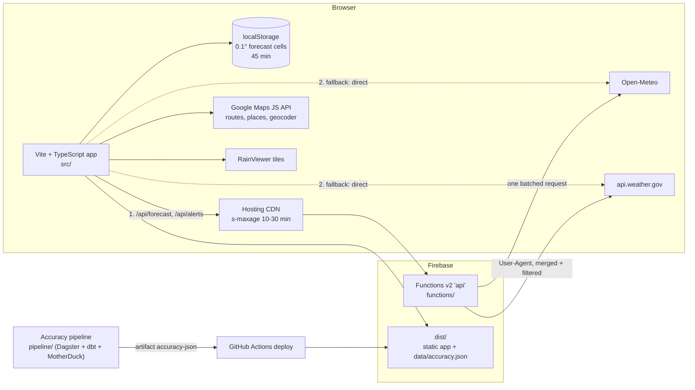

# RainMan-RouteWeatherApp

Weather can change any time while you’re taking a long road trip so “RainMan” lets you see all weather conditions
along your way between your location and destination, and recommends the best time to leave so you avoid rain/bad
weather and drive with clear sunny skies.
https://rainman-394303.web.app

## Departure time bar

Once a route is loaded, a bar along the bottom of the screen shows every departure hour (up to 48 hours ahead) as
green (good), yellow (okay) or red (bad), and highlights the best window to leave. Tap an hour to repaint the
weather markers on the route with the forecast you would meet if you left then. The bar scrolls sideways.

It needs no extra API calls per departure: one batched [Open-Meteo](https://open-meteo.com/) request returns about
96 hourly forecasts for every sampled point on the route. For a departure `d` hours from now and a point reached
`t` hours into the trip, the weather used is `hourly[round(d + t)]`. Hours are scored from the WMO weather code,
rain probability, wind and gusts, with extra penalties for ice (rain at or below 34 F) and night driving.
Scoring lives in `src/scoring/scoring.ts`, the Open-Meteo request and normalizer in `shared/weather.ts`, the cache
helpers in `src/weather/`, the map marker SVGs in `src/map/markerSvg.ts` (all pure TypeScript, no DOM or Google
dependencies) and the bar rendering in `src/ui/timebar.ts`.

## More features

- **Night shading**: departures that start after dark get a stripe under their time bar segment.
- **Severe weather alerts** (US only): up to 8 points along the route are checked against
  [api.weather.gov](https://www.weather.gov/documentation/services-web-api) (cached 15 min in `sessionStorage`).
  Moderate, Severe and Extreme alerts show in a dismissible banner.
- **Alternative routes**: up to 3 Google routes are scored in the same single Open-Meteo request. Route chips switch
  between them, and a hint appears when a drier route is within 15 minutes of the fastest.
- **Shareable links**: the URL keeps `?from=&to=&leave=` in sync; the Share button copies or shares it.
- **Rain radar** toggle using [RainViewer](https://www.rainviewer.com/) tiles (shown when zoomed out).
- **F/C toggle**, **recent trips** (last 5, in `localStorage`), **dark mode** (follows the system setting) and an
  **installable PWA** (`manifest.webmanifest`, `sw.js` precaches the built assets; weather, API and map requests are
  never cached).
- **Marker decluttering**: when zoomed out, overlapping weather markers are hidden (open one first, then the worst
  conditions, then evenly spread), at least 56 px apart.
- **Accuracy page** (`/accuracy.html`): how often the drive was actually dry when RainMan rated it green, by days
  ahead and by corridor, from the daily [accuracy pipeline](pipeline/README.md).

## Architecture



The browser asks the backend first. If `/api/**` is not deployed (404), unreachable or not JSON, the app falls back to
calling Open-Meteo and NWS directly, as it did before the backend existed, and remembers that for the session.

```
index.html, accuracy.html     the two pages (Vite entries)
src/main.ts                   loads Google Maps, wires the page
src/state.ts                  the single mutable app state
src/map/                      route search, samples, markers, popup places, radar, dark mode
src/weather/                  caches, batched forecast loading, backend client, icon mapping
src/scoring/                  badness, departure scores, best window
src/ui/                       time bar, panels, toast, popup
src/features/                 alerts, route chips, share links, recent trips, units, declutter
src/trip/                     address bar and recent trips glue
src/accuracy/                 the accuracy page
shared/                       code the app and the backend both use (Open-Meteo normalizer, NWS helpers)
functions/                    Firebase Functions backend (TypeScript)
e2e/                          Playwright suite (fake Google Maps, mocked Open-Meteo / NWS / RainViewer)
tests/                        Vitest unit tests
vite-plugins/                 build plugin that writes the service worker's precache list
scripts/                      firebase.json editor, shared-code sync, emulator smoke test
public/                       static files only: icons, images, manifest, 404 page
```

## Development

Requires Node 20.19 or newer.

```
npm ci
npm --prefix functions ci
cp .env.example .env.local     # put your Google Maps JS API key in VITE_GOOGLE_MAPS_KEY
npm run dev                    # http://localhost:5173
```

The Google Maps key is a browser key; restrict it by HTTP referrer (`localhost:5173/*`, your Hosting domain) in the
Google Cloud console. The live site’s key goes in `.env.production`, which `npm run build` uses (the deploy workflows
refuse to publish a build that still has the placeholder there).

Without the backend deployed, `npm run dev` calls Open-Meteo and NWS directly (the `/api` probe gets a 404 and the app
falls back). To develop against the functions, run the emulators (see below) and proxy `/api` to them.

### Scripts

| Command                                   | What it does                                                                                     |
| ----------------------------------------- | ------------------------------------------------------------------------------------------------ |
| `npm run dev`                             | Vite dev server                                                                                  |
| `npm run build`                           | Type-check, then build to `dist/` (hashed assets, service worker with its precache list)         |
| `npm run preview`                         | Serve `dist/` on :4173 with the same headers (CSP) as Firebase Hosting                           |
| `npm run typecheck`                       | `tsc --noEmit` for the app and for the tests                                                     |
| `npm run lint`                            | ESLint (flat config, typescript-eslint)                                                          |
| `npm run format` / `npm run format:check` | Prettier (no semicolons, double quotes, 2 spaces, 100 columns)                                   |
| `npm test`                                | Vitest unit tests                                                                                |
| `npm run test:e2e`                        | Playwright against `vite preview` (builds first)                                                 |
| `npm --prefix functions test`             | Backend handler tests                                                                            |
| `npm --prefix functions run build`        | Copies `shared/` into the backend, then compiles it                                              |
| `node scripts/emulator-smoke.mjs`         | Runs Hosting + Functions in the Firebase emulators and checks `/api/**` (needs the Firebase CLI) |
| `node scripts/sync-shared.mjs`            | Re-copies `shared/` to `functions/src/shared/` (a test fails when they differ)                   |

End-to-end tests use the Chromium Playwright downloads (`npx playwright install --with-deps chromium`). To use a
Chromium that is already installed, set `PLAYWRIGHT_CHROMIUM_PATH=/path/to/chromium`.

## Backend (Firebase Functions)

`functions/` holds one HTTPS function, `api` (Functions v2, Node 20, TypeScript):

- `GET /api/forecast?pts=lat,lng;lat,lng;…` validates at most 200 points and valid ranges, snaps each point to the
  0.1° grid, makes **one** batched Open-Meteo request for the distinct cells, normalizes it to the app’s hourly shape
  and answers with `Cache-Control: public, max-age=300, s-maxage=1800`.
- `GET /api/alerts?pts=…` (at most 20 points) asks `api.weather.gov` with a proper
  `User-Agent: RainMan (github.com/prajeshgpat/RainMan-RouteWeatherApp)`, merges and filters with the shared helpers,
  `s-maxage=600`. A partial answer is `no-store`.
- Per-IP token bucket in memory (60 requests per minute per instance, then `429` with `Retry-After`), structured JSON
  logs, and errors as JSON `{ "error": "…" }` with the right status.

The Open-Meteo normalizer and the NWS helpers are shared with the app through `shared/`. Firebase uploads only
`functions/`, so `functions/src/shared/` is a committed copy (`node scripts/sync-shared.mjs`); `npm test` fails when the
copy differs.

### Switching the backend on

The committed `firebase.json` has **no** `/api/**` rewrite: a Hosting deploy that rewrites to a function that does not
exist fails. Until you do this the site works exactly as before, calling Open-Meteo and NWS from the browser.

1. Upgrade the Firebase project `rainman-394303` to the **Blaze** (pay as you go) plan. Functions v2 needs it; the
   free tier covers this traffic comfortably.
2. Give the service account behind the `FIREBASE_SERVICE_ACCOUNT_RAINMAN_394303` secret these roles in Google Cloud IAM:
   **Cloud Functions Admin**, **Service Account User** and **Artifact Registry Administrator** (or Writer). The first
   deploy also enables the Cloud Build, Cloud Run and Artifact Registry APIs; the **Service Usage Admin** role lets it
   do that, or enable them once by hand.
3. Set the repository **variable** (Settings, Secrets and variables, Actions, Variables) `FUNCTIONS_ENABLED` to `true`.

From then on the deploy workflows run `node scripts/firebase-config.mjs --with-functions` (which adds the rewrite to
`firebase.json` in CI only), the merge workflow deploys the function, and Hosting sends `/api/**` to it. Set the
variable back to anything else to switch off.

To try it locally: `npm run build && npm --prefix functions run build && node scripts/emulator-smoke.mjs`.

## Accuracy page

`/accuracy.html` renders `/data/accuracy.json`, produced daily by the pipeline in `pipeline/` (see its README): the
headline dry rate of green trips, a hand-drawn SVG bar chart by days ahead, a per-corridor table and how it is measured.
The deploy workflows download the latest `accuracy-json` artifact of `pipeline.yml` into `dist/data/` before deploying;
without it the page says “Accuracy data not available yet”. `e2e/fixtures/accuracy.json` is a sample of the format.

## Continuous integration

- **Pull requests** (`firebase-hosting-pull-request.yml`): `npm ci`, typecheck, lint, format check, unit tests,
  functions tests and build, app build, Playwright e2e, then a preview channel deploy. The workflow has an explicit
  `permissions:` block (`contents: read`, `checks: write`, `pull-requests: write`) so the preview action can comment.
- **Merge to `main`** (`firebase-hosting-merge.yml`): the same checks, then the live deploy (and the functions deploy
  when `FUNCTIONS_ENABLED` is `true`). It can also be started by hand or by the accuracy pipeline
  (`workflow_dispatch`).
- Dependabot updates npm (root and `functions/`) and the GitHub Actions weekly.

## Security headers

`firebase.json` sets a Content-Security-Policy on every response that allows only the app, Google Maps
(`maps.googleapis.com`, `maps.gstatic.com`, `*.googleapis.com`), Google Fonts, Font Awesome on cdnjs, Open-Meteo,
`api.weather.gov`, RainViewer and `data:` images, plus `X-Content-Type-Options` and `Referrer-Policy`. The Playwright
suite runs against `vite preview`, which serves `dist/` with the same headers, and has a test that drives a route
through the app and fails on any CSP violation.

## Design decisions

- **One Open-Meteo request per route.** A route is sampled about every 25 miles (up to 60 samples, three alternative
  routes at once) and all samples go in one request with several coordinates, chunked at 150. Departure times need no
  further calls: a single request returns about 96 hourly forecasts per point, and the weather a driver meets is
  `hourly[round(departureOffset + eta)]`.
- **The 0.1° grid cache.** Forecasts are cached per 0.1° cell (about 7 miles) and requested at the cell centre, so
  nearby points, repeated searches, swapping start and destination and the other routes all share data. In the browser
  that is `localStorage` for 45 minutes; the backend snaps to the same grid, which makes the URLs the CDN caches
  identical across users.
- **The CDN cache via `s-maxage`.** Behind the Hosting rewrite, `s-maxage=1800` lets the Firebase CDN answer repeat
  forecast requests without waking the function or calling Open-Meteo. `max-age=300` keeps the browser from asking too
  often. Failures are `no-store` so an error is never shared.
- **Fallback instead of a hard dependency.** The backend is an optimisation, not a requirement. A 404, a network error
  or a non-JSON answer (for example an HTML fallback page) makes the app call the APIs directly, as it always did; a
  429 or 5xx falls back for that call only.
- **Declutter.** Zoomed out, 60 markers would cover the map. Markers are chosen greedily: the open one, then the worst
  conditions, then ones evenly spread along the route (both ends, the middle, the quarters…), keeping only those at
  least 56 × 64 px from every kept marker.
- **Scoring.** Each hour has a badness from 0 to 1: the WMO weather code or half the rain probability, whichever is
  worse, plus wind and gust penalties, ice (rain at or below 34 °F is 1) and a night penalty. A departure scores
  `0.6 × max + 0.4 × mean` of the badness at every sampled stop at the time you would reach it, so one bad stretch
  matters more than an average one. Under 0.2 is green, under 0.5 yellow, else red. The accuracy pipeline reimplements
  exactly this in SQL and checks it against the app’s test cases.
- **Service worker.** A small Vite plugin writes `dist/sw.js` with every built file, so the cache name changes with
  each deploy. Navigation is network first (a deploy shows immediately, the cached shell is the offline fallback);
  cross-origin requests, `/api/**` and `/data/**` are never touched.

## Credits

- Weather data by [Open-Meteo.com](https://open-meteo.com/), licensed
  [CC BY 4.0](https://creativecommons.org/licenses/by/4.0/). Used under the free non-commercial terms.
- Rain radar: [RainViewer](https://www.rainviewer.com/). Severe weather alerts: US National Weather Service.
- Weather icons: [Meteocons](https://github.com/basmilius/weather-icons) by Bas Milius, MIT license
  (see `public/icons/LICENSE`).
