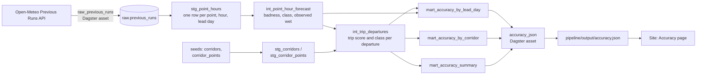

# RainMan forecast accuracy pipeline

**The question:** if you had trusted RainMan's green / yellow / red rating for a drive, made *N days in advance*, how often was the drive actually dry?

The pipeline replays the app's own scoring on the forecasts that were issued 1 to 5 days before each hour, compares them with what was observed, and publishes the result as `accuracy.json` for the site's Accuracy page.

> **Accuracy numbers build up over time.** The pipeline only ingests going forward. Every daily run fetches the last few days of Open-Meteo Previous Runs data (5 complete days by default) and upserts it. There is no historical backfill, so right after the first run the window is only a few days wide and the figures are noisy. The window grows by about one day per daily run, and the numbers get steadier as it does. `window` and `departures_evaluated` in `accuracy.json` always say what the numbers cover.

## Data sources

[Open-Meteo Previous Runs API](https://open-meteo.com/en/docs/previous-runs-api) (`previous-runs-api.open-meteo.com/v1/forecast`), several locations per request.

| What | Variables | Meaning |
| --- | --- | --- |
| Actuals | `weather_code`, `precipitation` (mm) | The model's analysis for that hour. Used as ground truth. |
| Forecast, lead day N (1 to 5) | `weather_code_previous_dayN`, `precipitation_probability_previous_dayN`, `temperature_2m_previous_dayN`, `wind_speed_10m_previous_dayN`, `wind_gusts_10m_previous_dayN` | The value for the same hour as predicted by the model run issued about N days earlier. |
| Daylight | `is_day` | Used for the app's night penalty. |

Units are °F and mph, times are unix seconds. Responses are stored verbatim in `raw.previous_runs` (with `fetched_at` and `request_url`), so everything downstream can be replayed from them.

## Corridors

Twelve popular US drives with varied weather live in the dbt seeds `corridors.csv` and `corridor_points.csv` (113 sample points). Points are known towns or interchanges on the real highway, roughly 10 to 55 miles apart (mostly 20 to 40). `eta_hours` is the cumulative great-circle distance times 1.12 at 60 mph. Both are generated by `scripts/gen_corridors.py`.

## Lineage



Code layout: `rainman_pipeline/` (Dagster: `definitions.py`, `assets/`, `resources.py`, `export.py`), `dbt/` (models, seeds, macros, tests), `schema/accuracy.schema.json` (the contract), `tests/` (pytest, with synthetic fixtures).

## Methodology and metric definitions

**Hour badness.** The dbt macro `rainman_badness` is a SQL port of `hourBadness` in `public/scoring.js`: a WMO weather-code table, a floor of `pop * 0.5` for the rain probability, wind (>20 mph +0.15, >30 mph +0.3) and gust (>45 mph +0.15) adds, freezing rain (liquid precipitation at or below 34 °F is 1.0), +0.1 at night, clamped to 0..1. `rainman_class` maps a score to **good** (green) below 0.2, **okay** (yellow) from 0.2 to below 0.5, **bad** (red) from 0.5. `tests/test_scoring_parity.py` replays `shared/scoring_cases.json`, generated from the current JS by `scripts/gen_scoring_cases.mjs`, and requires agreement to 1e-9. Regenerate the cases whenever `scoring.js` changes.

**Trip score.** For a departure at hour D the driver meets point i at hour `D + round(eta_i)`. The trip score is `0.6 * max(badness) + 0.4 * mean(badness)` over the points, like the app's `departureScore`, using the forecast issued `lead_day` days before each arrival hour. Only departures where every point has data are evaluated.

**Observed wet** (point hour): at least 0.1 mm of precipitation in the hour, or an analysis weather code of 51 or higher (drizzle, rain, snow, thunder; fog 45/48 does not count). A **trip is wet** if any point was wet at its arrival hour.

| Metric | Definition |
| --- | --- |
| `green_trip_dry_rate` | Share of trips rated green that were dry. This is the headline (lead day 1). |
| `okay_trip_dry_rate` | Share of trips rated yellow that were dry. |
| `bad_trip_wet_rate` | Share of trips rated red that were wet. |
| `brier_pop` | Mean squared error of the forecast rain probability against observed wet (point hours, 0 is perfect, always-50% scores 0.25). |
| `rain_pod` | Probability of detection: observed wet hours that were forecast wet. |
| `rain_far` | False alarm ratio: forecast wet hours that stayed dry. |
| `n_trips`, `n_point_hours` | Sample sizes behind each lead day. |

An hour counts as *forecast wet* when the rain probability is 50% or more, or the forecast weather code is a precipitation code. Rates are `null` when a class has no trips yet.

A healthy result has green trips drier than red ones (`green_trip_dry_rate` above `1 - bad_trip_wet_rate`) at the same lead day, a Brier score well under 0.25, and accuracy that falls as the lead day grows.

## Running locally

Python 3.12. From `pipeline/`:

```bash
uv venv .venv && source .venv/bin/activate     # or: python3.12 -m venv .venv
uv pip install -e . --group dev                # or: pip install -e . --group dev (pip >= 25.1)

ruff check .
pytest -q                                      # builds the fixtures through dbt, no network needed

# Offline end to end on SYNTHETIC data (not real weather):
python -m rainman_pipeline.fixtures            # loads tests/fixtures into .data/rainman.duckdb
(cd dbt && dbt build --target dev --profiles-dir .)
dagster definitions validate -m rainman_pipeline.definitions
```

With network access, the real thing against a local DuckDB file (`pipeline/.data/rainman.duckdb`, git-ignored):

```bash
dagster asset materialize -m rainman_pipeline.definitions --select '*'
cat output/accuracy.json
dagster dev -m rainman_pipeline.definitions    # UI, asset graph and the daily schedule
```

Set `RAINMAN_TARGET=prod` and `MOTHERDUCK_TOKEN` to use MotherDuck (database `rainman`, created if missing) instead. The ingestion window is configurable per run (`days`, default 5) but is always the most recent complete days.

Synthetic fixtures are regenerated with `python tests/fixtures/generate_synthetic.py`.

## Automation

`.github/workflows/pipeline.yml`:

* **Pull requests touching `pipeline/**`**: ruff, pytest, `dbt build --target dev` on the synthetic fixtures, and `dagster definitions validate`. No secrets.
* **Daily at 06:17 UTC and manual `workflow_dispatch`**: the same checks, then `dagster asset materialize` against MotherDuck, upload of the `accuracy-json` artifact (90 days), and `gh workflow run firebase-hosting-merge.yml` so the site redeploys with the new numbers. If the `MOTHERDUCK_TOKEN` secret is not set, the MotherDuck steps are skipped with a notice and the run still passes.

The site's deploy workflows download the latest `accuracy-json` artifact into `dist/data/accuracy.json`. Without it the Accuracy page shows "Accuracy data not available yet".

## Limitations

* **Short, growing window.** Previous Runs data only reaches back a few days per run and there is no backfill, so early numbers rest on little data and mostly reflect recent weather. Seasonal differences only show up after months.
* **Lead day is approximate.** `previous_dayN` is the model run issued about N days before the valid hour, not exactly N * 24 hours, and Open-Meteo blends several runs.
* **Actuals are analysis, not observations.** There are no gauge or radar readings. Model analysis hours can differ from what a driver saw, especially for small convective showers.
* **0.1 mm threshold.** Any hour with at least 0.1 mm counts as wet, so a trace of drizzle makes a trip "wet". Other thresholds would change every rate.
* **Grid-cell representativeness.** A forecast cell is several kilometres wide, and sample points are 10 to 55 miles apart, so rain between points is missed.
* **Twelve corridors.** Not a US-wide sample; results are not weighted by traffic or season.
* **Wet means any point.** A trip is wet if any single point was wet at its arrival hour, which is strict for long corridors.
* **Hour rounding.** Arrival hours use rounded ETAs at a flat 60 mph, ignoring traffic and stops.
* **Not independent samples.** Overlapping departures on the same storm are strongly correlated, so counts overstate certainty.
* **Probability is a model output.** Open-Meteo's precipitation probability is not guaranteed to be calibrated; Brier score and POD/FAR describe this model, not the weather services RainMan may use elsewhere.
